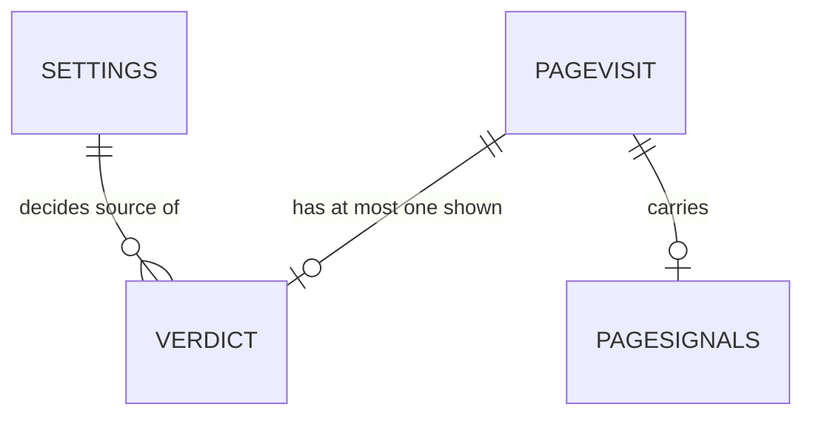

# Functional Specification — u1-core-check

Behaviour of the first thin slice: PageWatcher, VerdictService, JevAdapter, SettingsManager and BrowserPresenter. It implements stories US1.1, US1.2 (the fresh check, with reuse added by u3), US1.3, US2.1, US2.2, US4.1, US4.2, US4.3, US5.1, US5.2 and US6.1. Based on `entities.md`, `rules.md`, `stories.md` and `contract-summary.md`.

## Workflows

### W1. Check a page (US1.1, US1.2, US1.3, US4.1, US4.2, US4.3, US6.1)

1. A top-level page opens, or its address changes without a reload (BR1.1, BR1.2, BR1.5). PageWatcher creates a PageVisit with the stripped address (BR1.3), state `checking`, and a new visitId. The toolbar icon shows the checking state (BR4.1).
2. If the page cannot be checked (browser-internal, store page, local file): the visit gets `checkable` no; a Could not check verdict with failureKind `unsupported-page` is created at once; nothing is sent (BR5.3). Go to step 9.
3. PageWatcher collects the three signals on the page and attaches them to the visit, waiting at most 1 second; if they are not ready all three count as no (BR7.5, BR7.4).
4. VerdictService publishes state `checking` for the visit (BR8.1) and gets the source, server address and key from SettingsManager for this one request (BR6.2, BR6.3, BR6.8). The key goes only to the saved address, which is https.
5. If the selected source needs a key and none is saved: Could not check with `missing-key`, no request (BR5.4). If hosted OpenJev has no address: `missing-address`, no request (BR6.8). Go to step 9.
6. Without verdict memory, VerdictService starts a new attempt and asks the selected adapter for a fresh verdict (BR2.4, BR3.3). The adapter sends the request described in contract C7 (BR7.1, BR7.3, BR7.6) and starts the 5-second timer (BR5.1).
7. The adapter returns either a readable answer or a failure kind.
   - Readable answer: VerdictService turns the probabilities into a label with BR2.2 and writes the reason with BR2.3.
   - 401 rejected key: BR5.8. No connection: BR5.5. 429 or 529: BR5.6, no retry. 400, 413, 415 or 422: BR5.9. Unreadable: BR5.7. 5 seconds pass: BR5.1.
8. Before showing anything VerdictService checks the visit and the attempt: if the visit's state is `ended` the answer is discarded (BR3.1, BR3.2); if the answer is for an older attempt it is discarded (BR3.3); if the visit is already `timed-out`, the late answer is ignored (BR5.2).
9. The Verdict is published as a `verdict/updated` event (contract C3). BrowserPresenter updates the icon (BR4.1, BR4.2) and the popup (BR4.4). The current state of each tab is kept in short-lived browser session storage so a restart of the background process does not lose it (BR8.2).
10. If the person leaves the page or the address changes again, the visit's state becomes `ended`.

### W2. Check again (US2.2)

1. The person opens the popup (Enter or Space on the focused icon, BR4.3) and chooses Check again.
2. BrowserPresenter sends `verdict/recheck` for the current visit.
3. VerdictService starts a new check for that visit, ignoring any remembered verdict (BR4.5), and the icon returns to the checking state.

### W3. Save settings and test the connection (US5.1, US5.2)

1. The person opens Settings. If nothing is saved, a short hint explains what to enter (BR6.4).
2. The person picks the source, types the key and server address, and saves. An invalid address is rejected with an error beside the field naming the fix, and typed values are kept (BR6.6).
3. SettingsManager stores the source and address and keeps the key on the device only (BR6.1, BR6.3).
4. On Test connection, SettingsManager asks the adapter to test with the saved details and shows success or the reason it failed (BR6.5).
5. All fields and actions can be reached by keyboard and errors are text (BR6.7).

## State Machine: PageVisit

| Current state | Event | Guard | Next state | Actions |
|---------------|-------|-------|------------|---------|
| (none) | Page opens or address changes | top-level, not a frame | checking | Create the visit; show the checking icon |
| checking | Answer arrives | visit not ended, answer is for the latest attempt | answered | Show the verdict |
| checking | Answer arrives | answer is for an older attempt | checking | Discard the answer |
| checking | 5 seconds pass | no answer yet for the latest attempt | timed-out | Show Could not check with the reason |
| checking | Unsupported page | address not checkable | answered | Show Could not check with the reason; send nothing |
| answered, timed-out | Check again chosen | current visit | checking | New attempt: start a new check, ignore memory |
| checking | Check again chosen | current visit | checking | Supersede the waiting attempt, start one new attempt |
| timed-out | Late answer arrives | any attempt | timed-out | Ignore the answer |
| checking, answered, timed-out | Person leaves, or address changes | none | ended | Discard any later answer |
| ended | Answer arrives | none | ended | Discard the answer |
| (any) | Background process restarts | tab state not restorable | checking | Create a new visit for the open tab and check again |

Every state except `ended` has an outgoing transition, and `ended` is terminal.

## Entity Relationship (derived from entities.md)

Text fallback: a page visit has at most one shown verdict and carries one set of three signals; the settings decide which source produced each verdict.

## Rules Summary (derived from rules.md)

| Group | Rules | Stories |
|-------|-------|---------|
| Checking | BR1.1 to BR1.5 | US1.1 |
| Verdict | BR2.1 to BR2.4 | US1.2, US2.2 |
| Late answers | BR3.1, BR3.2 | US1.3 |
| Icon and popup | BR4.1 to BR4.5 | US2.1, US2.2 |
| Could not check | BR5.1 to BR5.8 | US4.1, US4.2, US4.3 |
| Settings | BR6.1 to BR6.7 | US5.1, US5.2 |
| Jev source | BR7.1 to BR7.4 | US6.1 |

## Stories This Unit Implements

US1.1, US1.2 (fresh check; the one-hour reuse and its criteria AC1.2.2 to AC1.2.4 are delivered by u3-verdict-memory), US1.3, US2.1, US2.2, US4.1, US4.2, US4.3, US5.1, US5.2, US6.1.

## Error Catalog

| Condition | failureKind | Person sees |
|-----------|-------------|-------------|
| No key saved | missing-key | A key is missing, with a link to Settings |
| Server answers 401 | rejected-key | The key was not accepted, with a link to Settings |
| Cannot connect | no-connection | There is no connection |
| 429 | rate-limited | The service is limiting requests |
| 529 | overloaded | The service is busy |
| 5 seconds pass | timeout | No answer came in time |
| Answer not readable | unreadable-answer | The answer could not be read |
| Request rejected by the service (400, 413, 415, 422) | unsupported-request | The request was not accepted |
| Hosted OpenJev selected with no address saved | missing-address | A server address is missing, with a link to Settings |
| Browser-internal, store or local-file page | unsupported-page | This page cannot be checked |

## Assumptions & Open Questions

- The "low confidence" starting value in BR2.2 is 0.6, a named constant tuned after the quality measurement. [assumption]
- The fixed sentences per chosen option (BR2.3) are written in Code Generation. [assumption]
- The unsupported-page and missing-address failure kinds are new beyond the contract's lists; the contract summary should gain them on its next revision. [assumption]
- Pages that cannot expose signals (for example when the browser forbids reading them) are treated as having all three signals set to no. [assumption]
