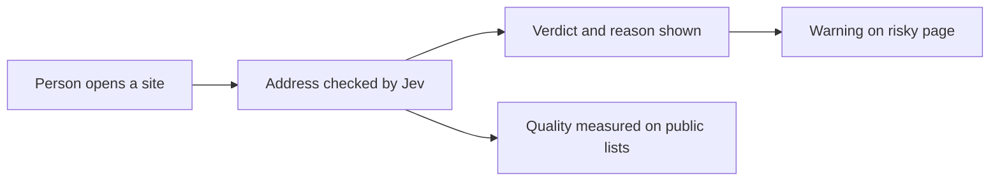

# Intent Backlog

Prioritized with MoSCoW, sequenced value first [Q3]. Each item is a proto-unit of work derived from `scope-document.md` (see also `intent-statement`, `feasibility-assessment` and `constraint-register`).

| Order | ID | Proto-unit | Scope items | MoSCoW | Depends on |
|-------|----|------------|-------------|--------|------------|
| 1 | B1 | Show a verdict for the current page using hosted Jev | S1, S4 (key entry) | Must | none |
| 2 | B2 | Warn on the page when a site is judged risky, with a short reason | S2, S3 | Must | B1 |
| 3 | B3 | Add hosted OpenJev as a second verdict source | S5 | Must | B1 |
| 4 | B4 | Measure detection quality on public lists | S6 | Must | B1 |
| 5 | B5 | Quick checks on the device before calling Jev | D1 | Could | B1 |
| 6 | B6 | Trusted-sites list | D2 | Could | B2 |

## Value Stream

Text fallback: person opens a site, then its address is checked by Jev, then a verdict and reason are shown and a warning appears on risky pages; quality is measured separately on public lists.

## Assumptions & Open Questions

- Ordering of B3 and B4 relative to each other is flexible; both only depend on B1. [assumption]
- B6 depends on B2 only because the warning is where a trusted site would stop being flagged. [assumption]
