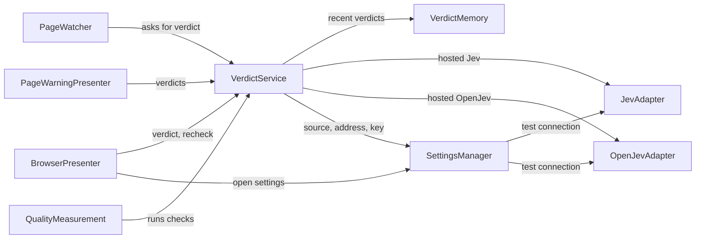

# Component Catalogue

Logical building blocks (code you write) for the Jev-based browser extension. Based on `requirements.md`, `stories.md` and the confirmed answers in `domain-design-questions.md` (Q1 to Q5). Deployment grouping is decided later in Units Generation; tech stack and NFR patterns belong to later stages.

## Part A: Machine-readable catalogue

```yaml
components:
  - name: PageWatcher
    summary: Notices when a top-level page opens, works out the address to check, and spots pages that cannot be checked.
    behaviour: >
      Reacts to each top-level page load (not frames). Removes the query string and fragment from the
      address before anything leaves the component. Marks browser-internal pages, store pages and local
      files as not checkable, so no request is made for them. Hands every page visit to the VerdictService.
    responsibilities:
      - Detect top-level page opens
      - Strip query strings and fragments from addresses
      - Mark pages that cannot be checked
    depends_on:
      - component: VerdictService
        interaction: Asks for a verdict for each page visit
        style: sync
    dependents: []
    external_dependencies:
      - name: Browser tab and navigation events
        kind: other
        purpose: Learn when a page opens
    entities:
      - name: PageVisit
        identifier: visitId
        attributes: [visitId, tabId, strippedAddress, checkable]

  - name: VerdictService
    summary: Produces one verdict for each page visit, within the time limit, and never for the wrong page.
    behaviour: >
      Looks in VerdictMemory first, then asks the selected source adapter, using the key and server
      address from SettingsManager. Stops waiting after 5 seconds and returns Could not check with a
      reason. Maps the source's answer to Safe, Suspicious, Dangerous or Could not check with a short
      reason. Ignores a late answer for a visit the person has already left. Does not remember Could not
      check results as verdicts unless the design later says so. Publishes verdicts to the presenters.
    responsibilities:
      - Orchestrate a check for a page visit
      - Apply the 5-second limit
      - Map source answers to the four labels and a reason
      - Guard against late answers for the wrong page
    depends_on:
      - component: VerdictMemory
        interaction: Reads and stores recent verdicts
        style: sync
      - component: JevAdapter
        interaction: Asks hosted Jev for a verdict when it is the selected source
        style: async
      - component: OpenJevAdapter
        interaction: Asks hosted OpenJev for a verdict when it is the selected source
        style: async
      - component: SettingsManager
        interaction: Gets the selected source, server address and key for each request
        style: sync
    dependents:
      - component: PageWatcher
        interaction: Asks for a verdict for each page visit
      - component: BrowserPresenter
        interaction: Shows the verdict and asks for a recheck
      - component: PageWarningPresenter
        interaction: Shows warnings for risky verdicts
      - component: QualityMeasurement
        interaction: Runs the same checks over a list of addresses
    external_dependencies: []
    entities:
      - name: Verdict
        identifier: verdictId
        attributes: [verdictId, strippedAddress, label, reason, source, checkedAt]

  - name: VerdictMemory
    summary: Remembers recent verdicts for a short time and forgets them when the source, key or server changes.
    behaviour: >
      Keeps a verdict for one hour unless changed, keyed by source and stripped address, so two addresses
      differing only by query string share one entry. Clears everything when the source, key or server
      address changes. Never stores the key.
    responsibilities:
      - Store and return recent verdicts
      - Expire verdicts after the time limit
      - Clear remembered verdicts when settings change
    depends_on: []
    dependents:
      - component: VerdictService
        interaction: Reads and stores recent verdicts
    external_dependencies:
      - name: Browser local storage
        kind: other
        purpose: Hold remembered verdicts on the device
    entities:
      - name: RememberedVerdict
        identifier: memoryKey
        attributes: [memoryKey, storedAt, expiresAt]
        references:
          - entity: Verdict
            owned_by: VerdictService
            relationship: each remembered verdict holds one verdict

  - name: JevAdapter
    summary: Asks hosted Jev for a verdict and translates its answer into the shared form.
    behaviour: >
      Sends only the stripped website address, with the key given for this request, to the hosted Jev
      address. Reports a missing or rejected key, no connection, a rate-limit answer and an unreadable
      answer as distinct failures. Never reads or stores the key itself and never writes it to logs.
    responsibilities:
      - Call hosted Jev
      - Translate its answer to the shared verdict form
      - Report distinct failure kinds
    depends_on: []
    dependents:
      - component: VerdictService
        interaction: Asks for a verdict when hosted Jev is selected
      - component: SettingsManager
        interaction: Tests the connection
    external_dependencies:
      - name: Hosted TypeSafe Jev
        kind: third-party-api
        purpose: Judges whether a website is phishing, a scam, malware or another risk
    entities: []

  - name: OpenJevAdapter
    summary: Asks a hosted OpenJev server for a verdict and translates its answer into the shared form.
    behaviour: >
      Same contract and privacy rules as JevAdapter, but for the OpenJev server address the person
      entered. Whether OpenJev needs a key is not yet confirmed.
    responsibilities:
      - Call hosted OpenJev
      - Translate its answer to the shared verdict form
      - Report distinct failure kinds
    depends_on: []
    dependents:
      - component: VerdictService
        interaction: Asks for a verdict when hosted OpenJev is selected
      - component: SettingsManager
        interaction: Tests the connection
    external_dependencies:
      - name: Hosted OpenJev server
        kind: third-party-api
        purpose: Judges whether a website is phishing, a scam, malware or another risk
    entities: []

  - name: SettingsManager
    summary: Owns the person's settings and the only copy of the Jev key; also provides the settings page.
    behaviour: >
      Stores the selected source, server address and key on the device only. Is the only component that
      reads or writes the key and hands it out only for a single request. Tells VerdictMemory to clear
      when the source, key or server changes. Provides the settings page and its Test connection action.
    responsibilities:
      - Store settings and the key on the device
      - Hand the key out only for a request
      - Provide the settings page and Test connection
    depends_on:
      - component: JevAdapter
        interaction: Test connection for hosted Jev
        style: async
      - component: OpenJevAdapter
        interaction: Test connection for hosted OpenJev
        style: async
    dependents:
      - component: VerdictService
        interaction: Gets the selected source, server address and key
      - component: BrowserPresenter
        interaction: Opens the settings page from the popup
    external_dependencies:
      - name: Browser local storage
        kind: other
        purpose: Keep settings and the key on the device
    entities:
      - name: Settings
        identifier: settingsId
        attributes: [settingsId, source, serverAddress, keyPresent]

  - name: BrowserPresenter
    summary: Shows the verdict on the toolbar icon and in the popup.
    behaviour: >
      Updates the icon with the right shield, symbol and accessible name for the current page. The popup
      shows the verdict, one short reason with Show more, Check again and a link to Settings. Never shows
      a verdict that belongs to a different page.
    responsibilities:
      - Show the toolbar icon states
      - Show the popup
    depends_on:
      - component: VerdictService
        interaction: Gets the verdict and requests a recheck
        style: sync
      - component: SettingsManager
        interaction: Opens the settings page
        style: sync
    dependents: []
    external_dependencies:
      - name: Browser toolbar and popup surfaces
        kind: other
        purpose: Display the icon and popup
    entities: []

  - name: PageWarningPresenter
    summary: Shows the slim banner for Suspicious pages and the overlay for Dangerous pages inside the visited page.
    behaviour: >
      Shows a dismissible banner for Suspicious and a modal overlay for Dangerous, each with a reason.
      Go back returns to the previous page or just closes the warning when there is none; Continue anyway
      closes it for this page load only. Must render the same on any page and must not be broken by page
      styles or scripts.
    responsibilities:
      - Show banners and overlays
      - Handle Go back, Continue anyway, Escape and focus
    depends_on:
      - component: VerdictService
        interaction: Gets verdicts for the page it sits in
        style: event
    dependents: []
    external_dependencies:
      - name: The visited web page
        kind: other
        purpose: The surface the warning is placed on
    entities: []

  - name: QualityMeasurement
    summary: Runs the same checks over public lists and reports the detection and false-alarm rates.
    behaviour: >
      Runs on demand over lists of known phishing and legitimate addresses through the VerdictService,
      so the numbers describe what people experience. Reports addresses that could not be checked
      separately and shows both rates.
    responsibilities:
      - Run checks over a list
      - Report detection and false-alarm rates and the unchecked count
    depends_on:
      - component: VerdictService
        interaction: Runs each address through the real check
        style: sync
    dependents: []
    external_dependencies:
      - name: Public lists of known phishing and legitimate sites
        kind: other
        purpose: The test data for the measurement
    entities:
      - name: MeasurementReport
        identifier: runId
        attributes: [runId, listName, phishingFlaggedShare, legitimateFlaggedShare, uncheckedCount]
```

## Part B: Human-readable view

### Component Diagram



Text fallback: PageWatcher, BrowserPresenter, PageWarningPresenter and QualityMeasurement all call VerdictService. VerdictService calls VerdictMemory, JevAdapter, OpenJevAdapter and SettingsManager. SettingsManager calls both adapters to test connections. BrowserPresenter also opens the settings page in SettingsManager.

### Component Summary

| Component | Purpose | Depends On | Dependents | Entities Owned |
|-----------|---------|------------|------------|----------------|
| PageWatcher | Notice page opens and strip addresses | VerdictService | none | PageVisit |
| VerdictService | One verdict per visit, within the time limit | VerdictMemory, JevAdapter, OpenJevAdapter, SettingsManager | PageWatcher, BrowserPresenter, PageWarningPresenter, QualityMeasurement | Verdict |
| VerdictMemory | Short-lived verdict memory | none | VerdictService | RememberedVerdict |
| JevAdapter | Talk to hosted Jev | none | VerdictService, SettingsManager | none |
| OpenJevAdapter | Talk to hosted OpenJev | none | VerdictService, SettingsManager | none |
| SettingsManager | Settings and the only copy of the key | JevAdapter, OpenJevAdapter | VerdictService, BrowserPresenter | Settings |
| BrowserPresenter | Toolbar icon and popup | VerdictService, SettingsManager | none | none |
| PageWarningPresenter | Banner and overlay on the page | VerdictService | none | none |
| QualityMeasurement | Detection and false-alarm measurement | VerdictService | none | MeasurementReport |

### Entity Ownership

| Entity | Owning Component | Identifier | Attributes | References |
|--------|------------------|------------|------------|------------|
| PageVisit | PageWatcher | visitId | visitId, tabId, strippedAddress, checkable | none |
| Verdict | VerdictService | verdictId | verdictId, strippedAddress, label, reason, source, checkedAt | none |
| RememberedVerdict | VerdictMemory | memoryKey | memoryKey, storedAt, expiresAt | Verdict (owned by VerdictService): each remembered verdict holds one verdict |
| Settings | SettingsManager | settingsId | settingsId, source, serverAddress, keyPresent | none |
| MeasurementReport | QualityMeasurement | runId | runId, listName, phishingFlaggedShare, legitimateFlaggedShare, uncheckedCount | none |

### External Dependencies

| Component | Dependency | Kind | Purpose |
|-----------|------------|------|---------|
| PageWatcher | Browser tab and navigation events | other | Learn when a page opens |
| VerdictMemory | Browser local storage | other | Hold remembered verdicts on the device |
| JevAdapter | Hosted TypeSafe Jev | third-party-api | Judge websites |
| OpenJevAdapter | Hosted OpenJev server | third-party-api | Judge websites |
| SettingsManager | Browser local storage | other | Keep settings and the key on the device |
| BrowserPresenter | Browser toolbar and popup surfaces | other | Display the icon and popup |
| PageWarningPresenter | The visited web page | other | Surface for warnings |
| QualityMeasurement | Public lists of known sites | other | Test data |

### Rationale

| Component | Why it is separate |
|-----------|--------------------|
| PageWatcher | Distinct concern: it reacts to browser events and is the only place addresses are stripped before use |
| VerdictService | Distinct concern and change rate: the check rules, time limit and stale-result guard change independently of sources and screens |
| VerdictMemory | Distinct data ownership and lifecycle: it expires on time and is cleared on settings change |
| JevAdapter / OpenJevAdapter | Distinct change rate: each source can change its address, key use or answer format on its own |
| SettingsManager | Distinct data ownership: the only holder of the key, which is a hard project rule |
| BrowserPresenter | Distinct runtime surface: the browser's own toolbar and popup |
| PageWarningPresenter | Distinct runtime surface and risk: it runs inside other sites' pages |
| QualityMeasurement | Distinct lifecycle: it runs on demand, not as pages open |

#### Component-boundary options

Option A (chosen): one adapter per source behind a shared contract. Easy to add a source, easy to test with mocked calls. Reversible.
Option B: one client with a switch for both sources. Fewer pieces but mixes two sources' differences into one place.
Recommendation and choice: A, because each source may change independently. See ADR-001.

The other boundary choices (verdict memory, the two presentation blocks, key access and the measurement tool) are recorded in `decisions.md`.

## Assumptions & Open Questions

- Whether OpenJev needs a key is not confirmed; SettingsManager holds the key either way. [assumption]
- The details of how a source's answer is mapped to Safe, Suspicious and Dangerous belong to Functional Design. [assumption]
- Whether Could not check results are remembered is left to Functional Design; the review noted it as open. [assumption]
- Single-page address changes are not covered by PageWatcher in this design and remain an open requirement. [assumption]
