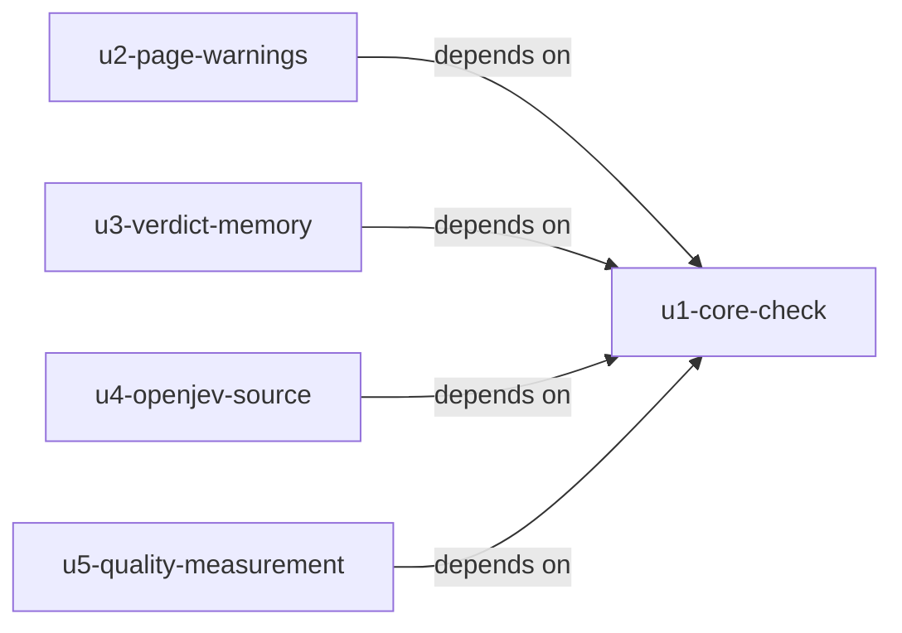

# Unit Dependencies

Topology only: what can depend on what. Delivery Planning chooses the order. Based on `unit-of-work.md` and `components.md`.

## Dependency DAG



Text fallback: u2-page-warnings, u3-verdict-memory, u4-openjev-source and u5-quality-measurement each depend on u1-core-check. u1-core-check depends on nothing.

```yaml
units:
  - name: u1-core-check
    kind: service
    depends_on: []
  - name: u2-page-warnings
    kind: ui
    depends_on: [u1-core-check]
  - name: u3-verdict-memory
    kind: library
    depends_on: [u1-core-check]
  - name: u4-openjev-source
    kind: service
    depends_on: [u1-core-check]
  - name: u5-quality-measurement
    kind: service
    depends_on: [u1-core-check]
```

## Integration Points

| From | To | What crosses | Source |
|------|----|--------------|--------|
| u2-page-warnings | u1-core-check | Verdicts for the page the warning sits in | components.md: PageWarningPresenter depends on VerdictService |
| u3-verdict-memory | u1-core-check | Remembered verdicts requested and stored by VerdictService | components.md: VerdictService depends on VerdictMemory |
| u4-openjev-source | u1-core-check | Source adapter contract; settings for the selected source and server | components.md: VerdictService and SettingsManager depend on OpenJevAdapter |
| u5-quality-measurement | u1-core-check | Addresses in, verdicts out | components.md: QualityMeasurement depends on VerdictService |

Where these cross a unit boundary, the contract is defined in Contract Design.

## Parallel Development Opportunities

After u1-core-check exists, u2-page-warnings, u3-verdict-memory, u4-openjev-source and u5-quality-measurement have no dependency on each other, so any of them could be built at the same time. [Q4] Several valid orders exist; Delivery Planning chooses.

## First Thin Slice

u1-core-check is the first resolved unit and the integrated slice: it can run alone, because it depends on nothing and includes the page watcher, the verdict service, the hosted Jev adapter, the settings and the icon and popup. [Q3, team practices]

## Notes

- A component sits in exactly one unit. The cross-unit calls above all point towards u1, so there are no cycles.
- U3 and U4 change VerdictService and the settings page in u1. They extend what u1 provides through its contracts rather than editing u1's code; the contracts are defined in Contract Design.

## Assumptions & Open Questions

- That u3 and u4 can extend u1 without editing it depends on the contracts defined in Contract Design. [assumption]
- If several units are built at the same time, each is built in its own copy of the project, so each unit's tests must pass with u1 present and none of the others. [assumption]
